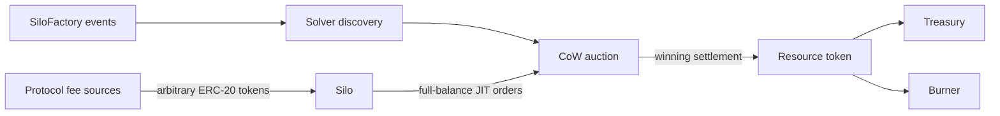

<p align="center">
  
</p>

# CoW Silo

CoW Silo converts protocol fee tokens through CoW Protocol solver competition.

A Silo sells the full balance of each fee token for one resource token. Its auction sets the minimum output for each sale. Solvers find balances and propose trades through CoW Protocol. Tokens need no registration, and the auction needs no keeper.

> [!WARNING]
> This repository is an early implementation. The contracts have not completed an audit. CoW Protocol must recognize deployed Silo addresses as surplus-capturing JIT-order owners before production use.

## Components

| Component | Purpose |
| --- | --- |
| `Silo` | Holds arbitrary fee tokens. It validates full-balance JIT sell orders with a resource-denominated minimum. |
| `SiloFactory` | Deploys Silo instances with CREATE2. It emits discovery events. It has no control over a Silo. |
| `ApprovalFundingAdapter` | Pulls approved source inventory into one Silo during `commit`. |
| `Burner` | Receives one resource token. Any account can move its full balance to `0x…dEaD`. |
| Solver SDK | Builds canonical orders, ERC-1271 payloads, order hashes, and commit interactions. |

The bridged burner is roadmap work. It is not part of this version.



## How the order works

The Silo fixes three values at deployment: `initialBuyAmount` and `minimumBuyAmount` (both `uint256`, in the resource token's smallest unit), and `auctionDuration` (`uint32`, in seconds). The floor, `minimumBuyAmount`, must be positive. For a declining auction, set the initial amount above the floor and use a positive duration. Equal amounts give a flat auction: `auctionDuration()` returns zero regardless of the supplied duration.

Each sell token's clock starts at Silo deployment. Only a full fill resets that token's clock. A deposit or a commit without a fill does not reset it. Before the duration ends, the minimum output is `initialBuyAmount - floor((initialBuyAmount - minimumBuyAmount) * elapsed / auctionDuration)`, where `elapsed` is the number of seconds since the clock started or last reset. At or after the duration, or for a flat auction, the minimum is `minimumBuyAmount`.

1. Read the sell token's balance and any expected adapter funding. Build a full-balance sell order with `buyAmount` at or above `currentMinimumBuyAmount(sellToken)`. A new sale can reset the minimum, so check the quote again before settlement.
2. Choose a Silo execution deadline no more than five minutes after the current block timestamp. Set the CoW order's `validTo` to `executionDeadline + auctionDuration()`. This keeps the fill record available until the minimum reaches the floor. It does not extend the Silo execution window. Check that the intended driver accepts the chosen CoW order lifetime.
3. Add `Silo.commit(order)` as a settlement pre-interaction. Use at most one active order per Silo and sell token in the batch. Orders for different sell tokens can settle together.
4. The winning settlement sells the full balance after funding and sends the resource token to the fixed recipient.

Funding is disabled by default. The owner can enable it with `setFundingAdapter`. During `commit`, the Silo attempts `fund(sellToken)` with a fixed 200,000 gas cap before checking its exact balance. It ignores adapter failure and return data. The cap does not guarantee success if the outer transaction has too little gas. Without funding, the prefunded Silo balance must still equal the order's sell amount.

`ApprovalFundingAdapter` has a fixed source and Silo recipient. The source approves the adapter, not the Silo or Vault Relayer. It transfers `min(source balance, source allowance to adapter)` into the Silo. Solvers must build the order for the current Silo balance plus expected funding and simulate the commit. Changes to inventory, allowances, or adapter configuration can make the exact-amount check revert. Source transfers roll back if the outer transaction reverts. A successful commit can leave funded inventory in the Silo without a sale. Replacing or disabling an adapter does not revoke source allowances. See the [protocol guide](./docs/pages/actors/protocols.mdx).

## Development

Requirements:

- Foundry with Cancun EVM support.
- Node.js 24 or later.
- pnpm 10.

```sh
git submodule update --init --recursive
pnpm install --frozen-lockfile
pnpm test
pnpm build
```

`pnpm test` runs the Solidity and SDK tests offline. The [auction clock proof](./test/proofs/README.md) uses the production Silo with pinned CoW Settlement bytecode on a local chain. Run the optional [mainnet fork tests](./integration/mainnet/README.md) with `pnpm test:mainnet`. These tests need an RPC endpoint and run only on a local fork.

Run the documentation site:

```sh
pnpm docs:dev
```

## Testnet deployment

Copy `.env.example` to `.env`. Set the testnet RPC URL, signer key, and CoW Settlement address. Deploy the factory first:

```sh
source .env
forge script script/DeployFactory.s.sol:DeployFactory \
  --rpc-url "$RPC_URL" --broadcast --verify
```

Set `SILO_FACTORY` in `.env` to the new factory address. Set `RESOURCE_TOKEN`, `RESOURCE_RECIPIENT`, `INITIAL_BUY_AMOUNT`, `MINIMUM_BUY_AMOUNT`, and `AUCTION_DURATION`. Use the resource token's smallest unit for both amounts and seconds for the duration. To use a Burner as the recipient, deploy it first.

```sh
source .env
forge script script/DeploySilo.s.sol:DeploySilo \
  --rpc-url "$RPC_URL" --broadcast --verify
```

No official Silo deployment exists. See [the deployment registry](./deployments/addresses.json).

## CoW integration status

The onchain and SDK paths are implemented and tested. The next integration step is an upstream CoW configuration change. It must add approved Silo owners, or an approved Silo factory, to the surplus-capturing JIT owner set. Without that change, Silo surplus does not count in solution scoring as intended.

The optional [offline integration profile](./integration/offline/README.md) starts a complete local CoW stack. It is separate from the fast unit-test loop.

## Documentation

The Vocs source is in [`docs`](./docs). It contains the protocol, solver, deployer, security, and deployment guides.

## License

GPL-3.0-or-later. See [LICENSE](./LICENSE).
