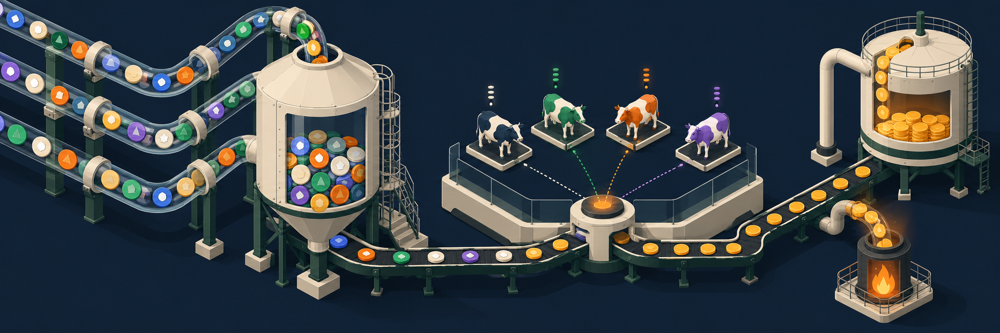
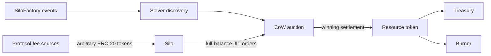

<p align="center">
  
</p>

# CoW Silo

CoW Silo converts protocol fee tokens through CoW Protocol solver competition.

The contracts are small. They do not contain a token registry, an oracle, a router, or a keeper. Solvers find Silo balances. Solvers set candidate prices. CoW Protocol selects the winning settlement.

> [!WARNING]
> This repository is an early implementation. The contracts have not completed an audit. CoW Protocol must recognize deployed Silo addresses as surplus-capturing JIT-order owners before production use.

## Components

| Component | Purpose |
| --- | --- |
| `Silo` | Holds arbitrary fee tokens. It validates full-balance JIT sell orders with a resource-denominated minimum. |
| `SiloFactory` | Deploys Silo instances with CREATE2. It emits discovery events. It has no control over a Silo. |
| `ApprovalFundingAdapter` | Pulls approved source inventory into one Silo during `prepare`. |
| `Burner` | Receives one resource token. Any account can move its full balance to `0x…dEaD`. |
| Solver SDK | Builds canonical orders, ERC-1271 payloads, and appData documents with a preparation pre-hook. |

The bridged burner is roadmap work. It is not part of this version.



## How the order works

1. A protocol sends fee tokens to a Silo or configures an optional funding adapter.
2. Solvers read the Silo balance and any expected adapter funding.
3. Each solver reads the current minimum buy amount and builds a JIT order at or above that value.
4. The order's appData specifies `Silo.prepare(sellToken)` as a pre-hook. The solver executes it before signature validation, directly or through the CoW Hooks Trampoline.
5. CoW Protocol scores the solutions.
6. The winning settlement sells the full token balance.
7. The settlement sends the resource token to the fixed recipient.

The Silo checks the token pair, recipient, full balance after funding, minimum buy amount, expiry, app data, fee, order kind, and balance type. The minimum is denominated in the resource token. It is an execution floor, not a market-price oracle. The owner can update the minimum and hook gas limit, and replace or disable the funding adapter. CoW competition is the price-discovery mechanism.

Funding is disabled by default. The owner can enable it with `setFundingAdapter`. Any account can call `prepare`; a call does not require an order or a later sale. During `prepare`, the Silo attempts `fund(sellToken)` with a fixed 200,000 gas cap. It ignores adapter failure and return data, approves the Vault Relayer, and records the resulting nonzero balance for this transaction. Repeated preparation for the same token reuses that balance without funding again. Signature validation requires the order amount to equal both the recorded amount and the current full balance.

The appData document has a fixed JSON shape and Silo target. It includes the calldata for `prepare(sellToken)` and the current `hookGasLimit`, which defaults to 500,000. The owner can change the limit with `setHookGasLimit`; zero is not valid. The Silo rebuilds the document and checks its complete hash. A gas-limit change requires a new exact document and hash for each sell token. The SDK returns the document for publication; a hash alone does not give solvers the hook. See the [solver guide](./docs/pages/actors/solvers.mdx).

`ApprovalFundingAdapter` has a fixed source and Silo recipient. The source approves the adapter, not the Silo or Vault Relayer. It transfers `min(source balance, source allowance to adapter)` into the Silo. Solvers must build the order for the current Silo balance plus expected funding and simulate the full settlement. Changes to inventory, allowances, or adapter configuration can invalidate the amount. Source transfers roll back if the outer transaction reverts. Successful preparation can leave funded inventory in the Silo without a sale. Replacing or disabling an adapter does not revoke source allowances. See the [protocol guide](./docs/pages/actors/protocols.mdx).

## Development

Requirements:

- Foundry with Cancun EVM support.
- Node.js 24 or later.
- pnpm 10.

```sh
git submodule update --init --recursive
pnpm install --frozen-lockfile
forge test
pnpm test
pnpm build
```

Run the optional [mainnet fork tests](./integration/mainnet/README.md) with `pnpm test:mainnet`. They use a public RPC and execute complete trades through the deployed Settlement and Vault Relayer on a local fork. The default tests remain offline.

Run the documentation site:

```sh
pnpm docs:dev
```

## Testnet deployment

Copy `.env.example`. Set `SETTLEMENT` to the canonical CoW Settlement for the target chain. Then deploy the factory and one Silo. No trampoline or appData deployment parameter is needed.

```sh
source .env
forge script script/DeployFactory.s.sol:DeployFactory \
  --rpc-url "$RPC_URL" --broadcast --verify

forge script script/DeploySilo.s.sol:DeploySilo \
  --rpc-url "$RPC_URL" --broadcast --verify
```

Set `MINIMUM_BUY_AMOUNT` in the resource token's smallest unit. Use the Burner address as `RESOURCE_RECIPIENT` when the resource token must leave circulation. Deploy the Burner first.

No official Silo deployment exists. See [the deployment registry](./deployments/addresses.json).

## CoW integration status

The onchain and SDK paths are implemented and tested. The next integration step is an upstream CoW configuration change. It must add approved Silo owners, or an approved Silo factory, to the surplus-capturing JIT owner set. Without that change, Silo surplus does not count in solution scoring as intended.

The optional [offline integration profile](./integration/offline/README.md) starts a complete local CoW stack. It is separate from the fast unit-test loop.

## Documentation

The Vocs source is in [`docs`](./docs). It contains the protocol, solver, deployer, security, and deployment guides.

## License

GPL-3.0-or-later. See [LICENSE](./LICENSE).
