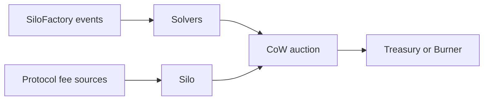

# CoW Silo

CoW Silo converts protocol fee tokens through CoW Protocol solver competition.

The Silo holds arbitrary ERC-20 tokens. It accepts JIT orders from CoW solvers. Each order sells the full balance of one token for one configured resource token.

The Silo has no token registry. It has no oracle, router, or keeper. Solvers provide discovery, pricing, and routing.

## System flow

## Start here

- Read [How it works](/how-it-works) for the order lifecycle.
- Read [Protocols](/actors/protocols) to integrate fee collection.
- Read [Solvers](/actors/solvers) to use Silo liquidity.
- Read [Security model](/security) before a deployment.

This implementation is unaudited. No official deployment exists.
