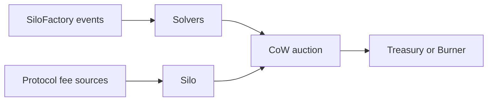

# CoW Silo

CoW Silo converts protocol fee tokens through CoW Protocol solver competition.

The planned production flow uses a permissionless watchtower to discover compatible Silos, read current order terms, and post regular orders to the CoW Order Book. Solvers compete to fill those orders through their standard auction flow. The watchtower and the contract changes for posted orders are planned work.

## Proof-of-concept flow

The current implementation uses solver-created JIT orders. Each order sells the full balance of one token for a configured resource token. The minimum buy amount is an output floor in that resource token. The Silo has no oracle.

## Start here

- Read [How it works](/how-it-works) for the planned production flow and the current proof of concept.
- Read [Protocols](/actors/protocols) for fee collection and integration.
- Read [Solvers](/actors/solvers) to try the solver-created JIT proof of concept.
- Read [Security model](/security) before a deployment.

This implementation is unaudited. No official deployment exists.
