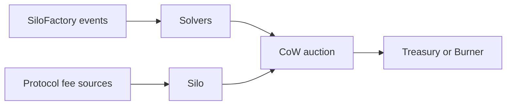

# CoW Silo

CoW Silo converts protocol fee tokens through CoW Protocol solver competition.

A Silo accepts just-in-time (JIT) sell orders from CoW solvers. Each order sells the full balance of one fee token for the configured resource token. The deployer fixes the initial output amount, floor, and auction duration. The minimum output falls to the floor over that duration, or stays constant if the two amounts are equal.

Each sell token starts on the deployment clock. A full fill restarts only that token's auction. Solvers read `currentMinimumBuyAmount(sellToken)` before building an order. Tokens need no registration, and the auction needs no oracle or keeper.

## System flow

## Start here

- Read [How it works](/how-it-works) for the order lifecycle.
- Read [Protocols](/actors/protocols) to integrate fee collection.
- Read [Solvers](/actors/solvers) to use Silo liquidity.
- Read [Security model](/security) before a deployment.

This implementation is unaudited. No official deployment exists.
